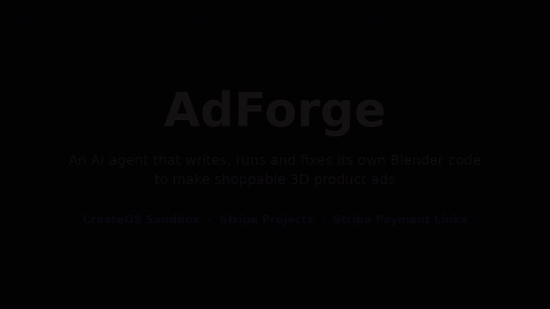
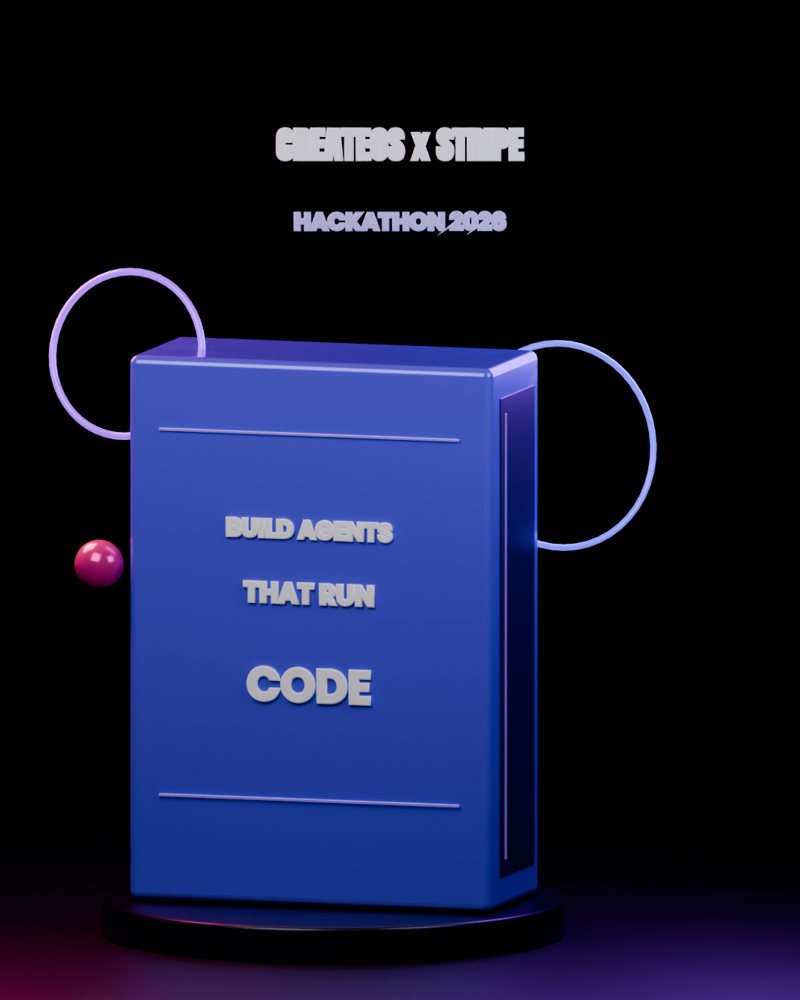
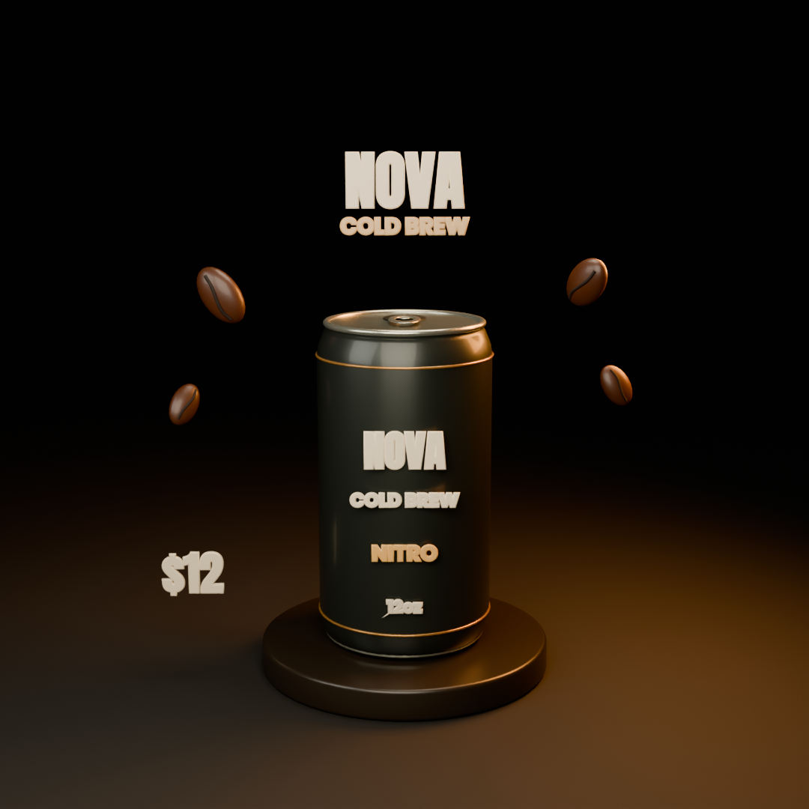
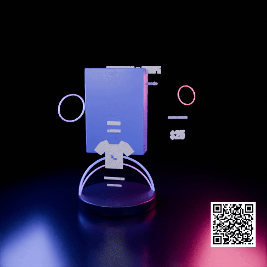

<p align="center">
  <h1 align="center">AdForge</h1>
  <p align="center"><b>An AI agent that writes, runs, and fixes its own Blender code to make shoppable 3D product ads.</b></p>
  <p align="center">CreateOS × Stripe Projects Hackathon</p>
</p>

<p align="center">
  <br>
  <a href="docs/demo.mp4"><b>Watch full video</b></a>
</p>

<p align="center">
  
  
  
</p>
<p align="center"><i>Every ad was written as code by the agent and rendered inside a CreateOS sandbox.</i></p>

## Why

Small brands can't afford 3D ads: it means hiring a motion designer or learning Blender.
And even a great ad dead-ends: it doesn't link to checkout. AdForge ads carry a scan-to-buy QR.

## How it works

1. **Stripe**: creates the product/price if needed, plus a Payment Link.
2. **Write**: an LLM writes a full Blender Python (`bpy`) scene script.
3. **Run**: headless Blender renders a draft inside a CreateOS Sandbox.
4. **Fix**: if Blender throws, the traceback is fed back and the model rewrites the script.
5. **Critique**: a vision critic scores the draft and the agent rewrites the scene from that critique.
6. **Ship**: final render, then ffmpeg in the sandbox composites the Stripe Payment Link QR onto the ad.

<p align="center">
  
  <br>
  <i>Draft 1 (critic 6/10) → final after self-critique</i>
</p>

## Sponsor tech

- **CreateOS Sandbox**: `createSandbox`, `files.upload` / `files.download`, `streamCommand` for live logs, auto-pause/resume to keep a warm Blender box. All generated code runs isolated, never on the host; Blender and ffmpeg both run in-sandbox.
- **Stripe Projects**: stack provisioned with `stripe projects init`, `add createos/project`, `add openrouter/api`, and `env --pull` to sync credentials.
- **Stripe**: Products, Prices, Payment Links, turned into a QR on every ad.

## Run it

Requires Node 20+.

```bash
npm install
stripe projects init
stripe projects add createos/project
stripe projects add openrouter/api
stripe projects env --pull
npm start   # http://localhost:3000
```

Env vars (in `.env`):

- `CREATEOS_SANDBOX_API_KEY`
- `CREATEOS_SANDBOX_BASE_URL` (e.g. `https://api-eu.sb.createos.sh`)
- `OPENAI_API_KEY` or `OPENROUTER_API_KEY`
- `STRIPE_SECRET_KEY` (optional, `sk_test_...`; enables Payment Link + QR)
- `LLM_MODEL` (optional)

## Repo map

- `src/agent.mjs`: the write → run → fix → critique → render → composite loop, streamed to the UI over SSE.
- `src/sandbox.mjs`: creates/resumes the CreateOS sandbox, installs Blender + ffmpeg, streams command output.
- `sandbox/adkit.py`: small Blender helper library the agent codes against.
- `src/stripe.mjs`: Stripe catalog, products, prices, Payment Links, QR codes.
- `public/index.html`: single-page UI with live logs, code versions, drafts, scores, and the final ad.

## Team

- Yogesh Singla
